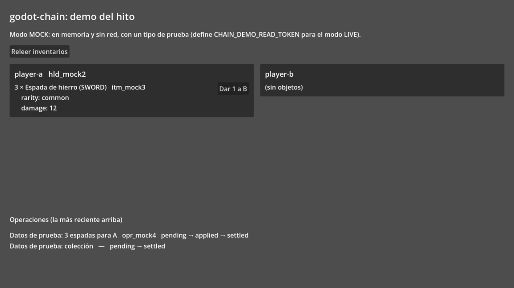

# godot-chain

Activos de Solana en Godot 4 sin que el jugador vea la cadena.

> **Antes de usar esto en un juego comercial.** Steam prohíbe en su proceso de
> onboarding los juegos construidos sobre tecnología blockchain que emitan o permitan
> el intercambio de criptomonedas o NFTs. Google Play y App Store lo permiten con
> restricciones. Verifica el texto vigente de las tres políticas antes de publicar: son
> la razón más común por la que un juego con activos on-chain no llega a la tienda.
>
> *Pendiente de contrastar con el texto literal actual de las tres políticas
> (`docs/seguimiento/verificaciones.md`, P4) antes de la entrega.*

---

## Qué es

Un **addon de Godot 4**, en GDScript puro y sin dependencias, que permite a un
desarrollador crear objetos de juego que existen como activos reales en Solana y
transferirlos entre jugadores, sin escribir código on-chain y sin que el jugador final
sepa que hay una blockchain debajo.

Proyecto de fin de máster. **Sólo devnet.** No apto para producción tal cual: ver
limitaciones.

## Problema que resuelve

Un estudio que quiere que los objetos de su juego existan como activos reales en una
blockchain choca hoy con tres obstáculos:

1. **El jugador tiene que entender la cadena.** Wallet, frase semilla, comisiones y firmas
   de cada transacción. Es fricción que la mayoría de jugadores no acepta, y un juego no
   debería pedírsela.
2. **El desarrollador tiene que escribir código on-chain.** Un estudio de Godot sabe
   GDScript, no Rust ni Anchor, y no debería tener que aprenderlos para dar un objeto a un
   jugador.
3. **Las claves acaban en el sitio equivocado.** Si el juego firma, la clave viaja dentro del
   binario, y cualquiera puede extraerla. Y si el cliente decide qué se gana un jugador,
   cualquiera puede darse lo que quiera.

`godot-chain` resuelve los tres. El juego llama a una API en GDScript que no menciona la
cadena. Las escrituras las autoriza un servidor del estudio y las firma un backend que
custodia las claves. Los objetos son tokens Token-2022 reales en Solana, y su historial
queda verificable en un explorador.

## Casos de uso

- **El estudio define su catálogo.** Desde la consola `/admin` crea colecciones y tipos de
  objeto (nombre, símbolo, URI y hasta 8 cualidades, como `rareza: épica`) y entrega las
  unidades iniciales a un jugador.
- **El juego enseña el inventario.** `Chain.inventory()` devuelve los objetos de un jugador
  a partir del identificador que el juego ya usa para él, sin direcciones ni claves.
- **Un jugador da objetos a otro.** El juego pide la transferencia con `Chain.transfer()`.
  El servidor de juego decide si se permite y quién la envía, y el juego ve su estado:
  `pending`, `applied` (aceptada) y `settled` (definitiva en la cadena). El juego sólo
  guarda estado cuando llega a `settled`.
- **Reintentos sin duplicados.** Si la red falla y el juego repite una petición, la misma
  operación no se ejecuta dos veces: cada escritura lleva una clave de idempotencia.
- **El estudio audita.** La consola lista cada operación con su estado y un enlace a su
  transacción en el explorador de Solana.
- **Desarrollo sin red.** En modo MOCK el addon responde en memoria con la misma forma que
  el backend, y el juego se puede programar y probar sin backend ni cadena.

## Arquitectura

```
Dispositivo del jugador                                    Navegador del estudio
    Proyecto Godot 4  +  addon godot-chain (GDScript)          consola /admin
        | transferencias                      | lecturas           |
        v                                     |                    | clave de administración
    game-server de ejemplo                    |                    |
        | clave de escritura                  |                    |
        v                                     v                    v
    chain-backend  (TypeScript + SQLite)  ------------------------------
        | claves derivadas de una semilla maestra por juego
        v
    Solana devnet  -  chain-assets (Anchor)  -CPI->  Token-2022
```

Las **escrituras** van del juego al servidor de juego y de ahí al backend, nunca
directas: la credencial que autoriza operaciones no puede viajar dentro del binario del
juego, y quien decide que un jugador se ha ganado un objeto tiene que ser un servidor
autoritativo, no el cliente. Las **lecturas** van directas del juego al backend con un
token de sólo lectura.

El juego no crea objetos. El **catálogo** (las colecciones y los tipos, con la entrega
inicial a un jugador) lo crea el estudio desde la consola `/admin`, y el servidor de juego
rechaza la creación con un `403`. Cada pieza tiene su credencial y con ella su papel; el
programa no define roles propios (ver `docs/vision-general/guia.md`).

### Diagramas

Arquitectura y flujo de datos, en Mermaid, en [`docs/diagramas.md`](docs/diagramas.md): las piezas y sus
credenciales, una transferencia de extremo a extremo, la creación de un tipo, la lectura del inventario,
los estados de una operación, las cuentas en la cadena y quién firma como autoridad.

### Cómo obtiene objetos un jugador

**Lo previsto.** Quien decide que un jugador se ha ganado un objeto es el servidor de juego: comprueba
con su lógica que ha ganado la partida o completado la misión y llama a `POST /v1/items/{item_id}/grants`,
que emite unidades nuevas para él. Ese endpoint está recortado en v1 (ver «Recortes»).

**Lo que hay en v1.** Las unidades sólo se emiten con la entrega inicial, al crear el tipo en `/admin`,
y después se mueven con transferencias. En la demo, el jugador A hace de almacén: recibe la entrega
inicial, y «Dar 1 a B» es como B adquiere objetos.

**Cómo lo haría un estudio con v1: una reserva.** Crea cada tipo con la entrega inicial a un tenedor
`game-reserve` y, cuando su servidor decide que un jugador ha ganado algo, transfiere desde la reserva.
El contrato y el backend ya lo admiten, porque `transfer` acepta cualquier emisor; el servidor de
juego del ejemplo no, porque siempre pone como emisor al jugador que pide. Cuesta lo mismo que una
emisión, pero las existencias quedan limitadas a la entrega inicial.

## Tecnologías

| Pieza | Tecnologías |
|---|---|
| Programa `chain-assets` | Rust, Anchor 1.2.2 (`anchor-lang` y `anchor-spl`), Token-2022 con las extensiones `MetadataPointer`, `TokenMetadata` y `PermanentDelegate`. Tests con LiteSVM 0.18.2 |
| Backend | TypeScript 6.0.3 sobre Node >= 22, Fastify 5.12.8, SQLite con better-sqlite3 13.0.3, `@solana/kit` 8.6.0 y un cliente del programa generado con Codama 1.11.0 a partir del IDL. Tests con Vitest 5.1.0 |
| Consola `/admin` | HTML, CSS y JavaScript sin compilación, servidos por el backend |
| Addon | GDScript puro para Godot 4.7.2, sin dependencias ni binarios. La red pasa por `HTTPRequest` |
| Servidor de juego de ejemplo | TypeScript, Fastify y better-sqlite3 |
| Custodia de la autoridad | Opcional: OpenBao 2.7.2, motor Transit. La autoridad firma dentro de OpenBao y su clave no sale de él |
| Red | Solana devnet |
| CI | GitHub Actions: tipos y tests del backend y del servidor de juego (y estilo y licencias en el backend), auditoría de dependencias, tests del programa, suite del addon con Godot sin pantalla, y guardias que impiden vocabulario de cadena, hilos y binarios en el addon |

## Estructura del repositorio

| Directorio | Contenido |
|---|---|
| `addon/addons/godot_chain/` | El addon. GDScript puro, cero dependencias, modos LIVE y MOCK. `addon/tests/` es su suite |
| `programs/chain-assets/` | El programa Anchor, que controla los activos Token-2022 mediante PDA. Desplegado en devnet |
| `backend/` | El servicio: TypeScript, Node >= 22, SQLite. Sirve el contrato HTTP y la consola `/admin` |
| `frontend/` | La consola de administración (dashboard web). La sirve el backend, sin compilación |
| `examples/chain-demo/` | Proyecto Godot de la demo sencilla que ejecuta el hito |
| `examples/game-server/` | Servidor de juego mínimo del hito: autoriza, registra y reenvía las transferencias |
| `rust/` | Workspace de Cargo de *Nidada*: reglas, GDExtension y servidor |
| `examples/godot-demo/` | Proyecto Godot de *Nidada*, un juego de mascotas aparte del hito |
| `docs/diagramas.md` | Diagramas de arquitectura y de flujo de datos, en Mermaid |
| `screenshots/` | Capturas de la consola, del explorador y de la demo |
| `docs/especificacion/propuesta-pfm.md` | **La especificación.** Única fuente de verdad |
| `docs/especificacion/http-contract.md` | **Contrato HTTP, congelado.** El artefacto del que cuelga todo |
| `docs/vision-general/guia.md` | Explicación legible del proyecto: actores, roles y quién manda sobre los activos |
| `docs/vision-general/lanzar-el-proyecto.md` | Cómo levantar el hito paso a paso, en devnet o sin red |
| `docs/vision-general/manual-del-estudio.md` | Manual para un estudio que adopta `godot-chain`: qué recibe, cómo lo integra, lo opera y qué falta para jugadores reales |
| `docs/seguimiento/verificaciones.md` | Hechos comprobados, con fecha, y lo que falta por comprobar |
| `docs/seguimiento/preguntas-tutor.md` | Lo que bloquea el proyecto y no decide quien implementa |
| `docs/juego/` | Diseño y plan de *Nidada* |

## Estado

**Librería:** el hito de la sección 7 de la propuesta está hecho y probado de extremo a
extremo en devnet: el estudio crea el catálogo en la consola, la demo de Godot lee los
inventarios y pide transferencias, y cada operación pasa por `pending → applied → settled`
(`docs/seguimiento/verificaciones.md`, V20 y V21). La CI cubre la sección 9 de la propuesta.
De los entregables del máster falta el vídeo (`docs/seguimiento/entregables.md`).

***Nidada*:** fases J1 (cuidado) y J5 (amigos y visitas) hechas, en escritorio. Es un
proyecto aparte, fuera del hito, y no usa `godot-chain`. Plan en `docs/juego/plan.md`.

## Capturas

De la consola `/admin` y del explorador de Solana, en devnet, con el juego `estudio-b`.

### 1. Dashboard principal


*El listado de catálogo: cinco tipos en dos colecciones, con sus cualidades y la operación que creó cada
uno, todas en `settled`.*

### 2. Formulario de registro


*Un tipo nuevo: colección, nombre, símbolo, cualidades y existencias iniciales para `game-reserve`. Del
identificador de llamada sale la `Idempotency-Key`, para que repetir el envío no cree dos tipos.*

### 3. Visualización de datos


*El inventario de `player-a`, leído de la cadena: sólo aparecen los tipos en `settled`.*

### 4. Transacción confirmada


*A la izquierda, una transferencia de «Moneda 2» de `player-a` a `player-b`, que ha pasado por
`pending → applied → settled`. A la derecha, su transacción en el Explorer de Solana: correcta,
finalizada y pagada por la autoridad del juego.*

### 5. Verificación exitosa


*La comprobación sin fiarse del backend. A la izquierda, el inventario de `player-a` en la consola, con
su cuenta en la cadena y el mint de cada tipo enlazados. A la derecha, la pestaña Tokens de la
transferencia anterior en el explorador. Coinciden la cuenta del jugador (`CzZ1M5…`), el mint de
«Moneda 2» (`HojYaK…`) y el saldo: 299 después de dar 1 a `player-b`.*

### La demo, sin red



*La demo de Godot en modo MOCK, sin backend ni red: inventarios de A y B, el botón «Dar 1 a B» y el estado
de cada operación.*

## Vídeo

Demostración en 5 minutos: el estudio crea un tipo en la consola, el juego da una unidad de A a B y la
transacción se ve en el explorador de Solana. **Enlace pendiente de publicar.** Guion en
`docs/seguimiento/guion-video.md`.

## Programa `chain-assets`

Programa Anchor mínimo y sin lógica de juego. No guarda saldos ni reimplementa tokens: los
activos son mints Token-2022 y el programa sólo los controla por CPI.

**Program ID (devnet):** `4SUNiKmyk4QtXhU2oNGn6uiXiSUevRdmXpZdRFXPeLNz`
([explorador](https://explorer.solana.com/address/4SUNiKmyk4QtXhU2oNGn6uiXiSUevRdmXpZdRFXPeLNz?cluster=devnet))

### Cuentas y PDA

| Cuenta | Semillas | Qué es |
|---|---|---|
| `Game` | `["game", game_id]` | Un juego. Guarda `authority` (la única clave que firma y paga), `game_id` y `bump`. Tiene todos los poderes sobre los activos del juego |
| Mint de un tipo | `["item", game, item_seed]` | Un tipo de objeto: mint Token-2022 de 0 decimales con `MetadataPointer`, `PermanentDelegate` y `TokenMetadata`. `item_seed` la calcula el backend a partir del `item_id` |
| Cuenta de token del tenedor | Cuenta asociada (mint + tenedor) | El saldo de un jugador. El tenedor es una clave derivada por el backend que nunca firma |

La PDA `Game` es, en cada mint, autoridad de acuñación, autoridad del puntero y de la
actualización de metadatos, y delegado permanente. Ningún mint tiene autoridad de congelación.

### Instrucciones

Todas tienen una sola firma requerida: la autoridad del juego, que también paga. Las PDA
firman por CPI.

| Instrucción | Qué hace | Evento |
|---|---|---|
| `initialize_game(game_id)` | Crea `Game` y fija como autoridad a quien firma. `game_id` cumple `[a-z0-9-]{1,32}` | `GameInitialized` |
| `rotate_authority(new_authority)` | Cambia la autoridad. Los mints no cambian, porque sus poderes los tiene `Game` | `AuthorityRotated` |
| `create_item(args)` | Crea el mint de un tipo con sus metadatos: nombre, símbolo, URI, colección y hasta 8 cualidades | `ItemCreated` |
| `grant(amount)` | Acuña unidades a un tenedor y crea su cuenta de token si hace falta | `ItemGranted` |
| `transfer(amount)` | Mueve unidades entre dos tenedores con `Game` como delegado permanente. El emisor no firma | `ItemTransferred` |

Cada instrucción tiene sus tests negativos: 30 tests con LiteSVM en
`programs/chain-assets/tests/`. Los errores propios están en `programs/chain-assets/src/error.rs`.

## Innovaciones

Lo que este proyecto añade frente a un programa Anchor con wallet en el navegador:

- **Activos reales, no cuentas propias.** Los objetos son mints Token-2022 con sus metadatos
  en el propio mint, sin Metaplex. El programa no guarda saldos ni reimplementa tokens: sólo
  tiene los poderes sobre ellos y los ejerce por CPI.
- **Jugador sin wallet.** El jugador no firma, no paga comisiones y no ve la cadena. Su
  identidad es la que ya le da el juego, y el backend deriva de ella su dirección.
- **Firmante único.** Toda transacción tiene una sola firma requerida: la autoridad del
  juego, que también paga. Los mints son PDA y firman por CPI, y la PDA del juego mueve los
  objetos como delegado permanente. Un test lo verifica.
- **Autoridad rotable sin tocar los activos.** Los poderes los tiene la PDA del juego, no la
  clave. Cambiar la clave es una sola instrucción, `rotate_authority`.
- **Autoridad que firma sin salir de OpenBao.** Con OpenBao Transit, la clave de la autoridad
  no llega nunca al backend: le pide cada firma y la comprueba antes de usarla. Rotarla es crear
  una versión nueva de la clave y ejecutar `npm run rotate-authority`.
- **Idempotencia de extremo a extremo.** La clave de idempotencia se registra en SQLite
  antes de tocar Solana, así que un reintento nunca acuña ni transfiere dos veces.
- **Estados `applied` y `settled`.** El juego distingue una operación aceptada de una
  definitiva en la cadena, y sólo guarda estado con la segunda.
- **Un addon de Godot sin vocabulario de cadena.** La API pública no habla de claves,
  cuentas ni comisiones, y la CI lo comprueba con `grep` en cada cambio.
- **Contrato HTTP congelado.** El addon, el servidor de juego y el backend dependen de un
  contrato escrito (`docs/especificacion/http-contract.md`), no unos de otros.

## Requisitos

- Node >= 22 (desarrollado con 24.12.0)
- Godot 4.7.2
- CLI de Solana, configurada en devnet, para financiar la autoridad del juego
- Sólo para modificar el programa: Anchor 1.2.2 y Solana 4.1.2, en Linux o WSL. Anchor no
  funciona nativo en Windows. Lanzar el hito no lo necesita: el programa ya está desplegado
- Sólo para *Nidada*: Rust 1.94.0, fijado en `rust/rust-toolchain.toml`. En Windows, ver
  `rust/README.md`

## Instalación y ejecución

Los pasos completos, con las credenciales, la creación del juego y el recorrido del hito,
están en `docs/vision-general/lanzar-el-proyecto.md`. Sin red, la demo arranca en modo MOCK:
basta con abrir `examples/chain-demo` en Godot y ejecutarla.

### Autoridad en OpenBao (opcional)

Por defecto la autoridad es la clave derivada de la semilla. Para que firme dentro de OpenBao:

```bash
# OpenBao de desarrollo: guarda todo en memoria y se pierde al pararlo. No lo uses con un juego que quieras conservar
docker run --rm -p 127.0.0.1:8200:8200 openbao/openbao:2.7.2 server -dev -dev-root-token-id=dev-root -dev-listen-address=0.0.0.0:8200
B=http://127.0.0.1:8200/v1; H="X-Vault-Token: dev-root"
curl -H "$H" -X POST $B/sys/mounts/transit -d '{"type":"transit"}'
curl -H "$H" -X POST $B/transit/keys/chain-authority -d '{"type":"ed25519"}'

# Las mismas variables que npm start, y además:
export CHAIN_AUTHORITY_SIGNER=transit CHAIN_BAO_ADDR=http://127.0.0.1:8200 CHAIN_BAO_TOKEN=dev-root CHAIN_BAO_TRANSIT_KEY=chain-authority
npm run init-game          # un juego nuevo, ya con la clave de OpenBao
npm run rotate-authority   # o pasar a OpenBao un juego existente; da la orden para financiar la autoridad nueva
npm start
```

Para rotar más adelante: parar el backend, `curl -H "$H" -X POST $B/transit/keys/chain-authority/rotate`,
financiar la dirección nueva, `npm run rotate-authority` y arrancar. Prueba en devnet:
`docs/seguimiento/verificaciones.md`, V23.

**Como lo tendría un estudio.** OpenBao con almacenamiento `raft` en un volumen (OpenBao 2.7 ya no
tiene `file`), inicializado con claves de desellado (`POST /v1/sys/init`) y desellado tras cada
arranque. El backend no usa el token raíz, sino uno con una política que sólo le deja firmar y leer
la clave pública, y la rotación va en otra política, la del operador:

```hcl
# chain-backend
path "transit/sign/chain-authority" { capabilities = ["update"] }
path "transit/keys/chain-authority" { capabilities = ["read"] }

# chain-operator
path "transit/keys/chain-authority/rotate" { capabilities = ["update"] }
path "transit/keys/chain-authority"        { capabilities = ["read"] }
```

Probado con un segundo estudio en devnet, incluidos un reinicio y el desellado (V24). Si se pierden las
claves de desellado o el volumen, se pierde la clave de la autoridad, y con ella el juego.

## Desarrollo

```bash
# Backend: tipos, estilo y tests
cd backend
npm ci
npm run typecheck
npm run lint
npm test

# Servidor de juego
cd examples/game-server
npm ci && npm run typecheck && npm test

# Addon, en modo MOCK, desde la raíz
godot --headless --path addon --import             # sólo la primera vez
godot --headless --path addon --script res://tests/run.gd

# Programa, en Linux o WSL, desde la raíz
anchor build                                       # .so e IDL
cargo test -p chain-assets                         # LiteSVM, sin red

# Sólo Nidada
cd rust
cargo test
cargo clippy --all-targets -- -D warnings
./build-ext.sh        # compila nidada-ext y la copia al proyecto Godot
```

## Limitaciones aceptadas conscientemente

Son decisiones, no defectos:

1. **La cadena certifica catálogo y propiedad, no estado individual.** Los activos son
   fungibles: las unidades son indistinguibles y nada sobrevive a la transferencia
   salvo la cantidad. Las `qualities` describen el tipo, no el ejemplar. Si un objeto tiene
   que diferenciarse (durabilidad, nivel, encantamiento), hay tres salidas: un tipo por
   variante, que sirve si hay pocas; guardar el estado de cada ejemplar en el servidor de
   juego, que no viaja con una transferencia; o un mint por objeto (NFT), que es otro modelo
   y queda fuera del proyecto.
2. **La semilla maestra vive en un fichero, no en un HSM.** Si la autoridad sale de la
   semilla, quien lea ese fichero controla todos los activos del juego. Con la autoridad en
   OpenBao Transit, la semilla ya no da la autoridad, pero sigue dando las claves de los
   jugadores, que son dueñas de sus cuentas: quien la lea puede mover los objetos de cualquier
   jugador, aunque no crear tipos, emitir ni quedarse con el juego.
3. **El jugador no posee de verdad.** Las claves las custodia el backend, el delegado
   permanente permite mover sus objetos sin su consentimiento, y no hay vía de salida a
   una wallet propia.
4. **`NonTransferable` no está activado y no puede añadirse después.** Todo objeto
   creado en v1 es transferible para siempre.
5. **El `read_token` es público de facto.** Va en el binario del juego; cualquiera
   puede extraerlo y consultar el inventario de cualquier jugador de ese juego.
6. **El modo mock puede divergir del backend real.** No hay tests de conformidad que lo
   impidan.
7. **Una sola instancia del backend.** SQLite en fichero; escalar horizontalmente
   rompería la idempotencia.
8. **El identificador de jugador debe ser inmutable.** Si cambia, sus objetos quedan
   bajo una clave derivada que nadie reclama.
9. **`chain-assets` no está auditado.** Tiene poder sobre todos los activos de cada juego:
   apto para devnet, no para mainnet sin una auditoría.
10. **Quien tenga la autoridad de actualización del programa controla todos los juegos.**
    En devnet se conserva para poder corregir errores; un despliegue real tendría que
    congelarla o que cada estudio desplegara su propio programa.
11. **Cada tipo que recibe un jugador por primera vez cuesta un depósito que no se recupera.**
    La autoridad paga la cuenta de tenencia, 0,00152 SOL, y en v1 no se puede cerrar: hacerlo
    exige la firma del jugador, que sería una segunda firma. El coste crece con jugadores × tipos
    distintos por jugador, no con las unidades (`docs/seguimiento/verificaciones.md`, V22).
12. **El servidor de juego de ejemplo acepta todas las peticiones.** No autentica al jugador:
    pone siempre como emisor de una transferencia al configurado en `GAME_SERVER_PLAYER`, y
    cualquiera que llegue a él puede mover sus objetos. El hueco es a propósito: saber qué
    jugador hace cada petición es la autenticación del estudio (sus cuentas, Steam…), y el
    servidor de juego es donde la conecta. Por eso escucha por defecto sólo en `127.0.0.1`
    (`docs/vision-general/guia.md`, «El hueco del ejemplo»).

## Coste en la cadena

Lo paga todo la autoridad del juego. Medido en devnet; la renta de mainnet es la misma (V22).

| Operación | Coste |
|---|---|
| Derivar la clave de un jugador, crear una colección, leer | 0 |
| `initialize_game`, una vez por juego | 0,00105 SOL |
| Crear un tipo típico, con su entrega inicial | 0,00465 SOL |
| Primera unidad de un tipo para un jugador | 0,00152 SOL, depósito no recuperable |
| Cualquier otra transferencia | 0,000005 SOL |

Casi todo el gasto son los depósitos de las cuentas de tenencia, uno por jugador y tipo. Un estudio
con 20.000 jugadores que tengan de media 10 tipos distintos pagaría unos 304 SOL en depósitos y 0,1
SOL por cada 20.000 transferencias. Lo que lo reduce es crear menos cuentas:

- **Entregar sólo a quien juega.** En vez de transferir a todos, el servidor de juego apunta lo que
  corresponde a cada jugador y lo transfiere cuando entra. Los jugadores inactivos no cuestan nada;
  a cambio, hasta entonces ese objeto sólo existe en su base de datos.
- **Menos tipos distintos por jugador.** Cantidades en vez de variedad (cinco pociones de un tipo, no
  cinco tipos de poción), y fuera de la cadena lo que no se intercambia ni necesita certificarse.

Agrupar transferencias en una transacción sólo ahorra comisiones, y cerrar cuentas vacías para
recuperar el depósito exige la firma del jugador (limitación 11).

## Procedimiento de rotación ante compromiso de la semilla

Escrito, no implementado. Si la autoridad está en OpenBao Transit, la semilla no da la
autoridad: el paso 2 no hace falta y la carrera del final desaparece. Rotar la autoridad sí está
implementado, con `npm run rotate-authority` (ver «Autoridad en OpenBao»).

1. Generar una semilla maestra nueva y una autoridad nueva.
2. Ejecutar `rotate_authority` con la autoridad antigua. Los activos no cambian, porque sus
   poderes los tiene la PDA del juego.
3. Para cada tenedor, mover su saldo a la dirección derivada de la nueva semilla con
   `transfer`.
4. Republicar el mapa `holder_id` -> dirección.
5. Destruir la semilla comprometida.

Es una carrera: quien tenga la semilla comprometida también puede ejecutar
`rotate_authority`, y si lo hace primero, el estudio pierde el juego.

## Recortes

Aplicados por la línea de corte (propuesta, 8.1) porque el calendario no da para más:

- **Editar un tipo e importar un catálogo.** No hay `PATCH /v1/items/{id}` (contrato 4.6), ni
  la instrucción `update_item`, ni la importación de `catalog.json`. Una vez creado un tipo, su `name`,
  su `uri` y sus `qualities` no se pueden cambiar en v1. El diseño lo deja abierto: la PDA del juego
  es la autoridad de actualización de los metadatos, así que no quedaron fijados para siempre, y la
  edición está descrita en la propuesta (sección 3, «Catálogo declarativo»). `symbol`, colección y entrega
  inicial no serán editables nunca: cambiarlos exige un tipo nuevo.
- **Entregar unidades después de crear un tipo.** `POST /v1/items/{item_id}/grants` sigue en el
  contrato, pero sin implementar. `POST /v1/items` ya emite la cantidad inicial, y para eso conserva la
  instrucción `grant` del programa.
- **Probar reversiones en el modo MOCK.** No hay `mock_force`: el mock sólo cubre el camino feliz, así
  que en MOCK no se puede ver una operación que acaba en `failed`.
- **Backoff en el sondeo.** El addon consulta el estado de las operaciones a intervalo fijo, con un
  `Timer`.
- **Transferir desde la consola.** Las transferencias se piden desde la demo de Godot, a través del
  servidor de juego. La consola sólo entrega unidades al crear un tipo, con la entrega inicial.

## Trabajo futuro

- **Entrar a la consola con una wallet.** El jugador no tiene wallet, porque esa es la premisa del
  proyecto. El estudio sí podría entrar en `/admin` con una (*Sign-In With Solana*), validada contra
  una lista de claves autorizadas en el backend, como alternativa a `CHAIN_ADMIN_KEY`. Pero sólo
  cambiaría cómo se autentica el administrador, no quién firma en la cadena: todas las operaciones las
  sigue firmando la autoridad del juego desde el backend. Para que una wallet tuviera poder propio
  sobre los activos, `chain-assets` necesitaría un rol de administrador separado de la autoridad, con
  su propia instrucción. Si esa wallet firmara junto a la autoridad, se rompería la regla de un único
  firmante. Y si sustituyera a la autoridad, el servidor de juego ya no podría hacer transferencias.
- **Entrar a la consola con una cuenta de OpenBao.** Una alternativa a `CHAIN_ADMIN_KEY`, compartida
  por todo el estudio. En OpenBao, cada persona tiene su cuenta (`userpass` u OIDC), con una política
  que le permite leer `godot-chain/consola/<game_id>`, una ruta que no guarda nada y sólo sirve de
  etiqueta. La consola pide usuario y contraseña, y el backend los reenvía a
  `auth/userpass/login/<usuario>`. Con el token que recibe, pregunta a `sys/capabilities-self` si
  puede leer esa ruta, y después lo anula (`auth/token/revoke-self`). Si puede, emite la cookie de
  sesión de siempre; si no, responde `403`. Así cada persona tiene su acceso, se puede retirar sin
  repartir una clave nueva, OpenBao registra quién entró y el acceso se da juego por juego. El
  backend no necesita otro token: el de Transit sigue firmando sólo con la autoridad, y ninguna
  cuenta de la consola puede firmar. Falta resolver una cosa: si se retira el acceso a alguien, la
  cookie que ya tiene sigue valiendo hasta que caduque, que hoy son 8 horas. Transit no sirve para
  esto, porque no identifica a nadie: firma con claves que no salen de OpenBao.
- **Reparto masivo desde `game-reserve` en la consola.** Una transferencia por jugador, con la clave
  de idempotencia `reparto_<campaña>:<holder_id>` para que un reparto cortado se pueda reanudar sin
  entregar dos veces. Hay que resolver antes cuatro cosas: el backend sólo conoce a los jugadores que
  alguna operación ha nombrado, el nodo RPC público limita la tasa, hay que comprobar antes que la
  reserva y la autoridad alcanzan para todos, y la consola tiene que mostrar el avance de N
  operaciones. Con 20.000 jugadores que aún no tengan el tipo, cuesta unos 30 SOL cada vez.
- **Tokens comprimidos (*ZK Compression*).** Guardar las cuentas de tenencia comprimidas evitaría el
  depósito por cuenta, que es casi todo el coste. **Sin verificar:** falta leer su documentación
  vigente y comprobar si admite las extensiones Token-2022 que usa `chain-assets`. Cambiaría el
  programa, los constructores del backend y las lecturas del inventario.

## Uso de IA

El proyecto se ha desarrollado con **Claude Code** (Anthropic), en el terminal y en VS Code. Casi todos los
commits llevan la línea `Co-Authored-By` de Claude. Cómo se ha usado:

- **`CLAUDE.md` en la raíz desde el primer commit**, con los invariantes en imperativo: firmante único,
  marcar antes de llamar, cero vocabulario de cadena en `addon/`, nada fuera del hito. Es lo que impide que
  el alcance crezca solo, y la CI comprueba con `grep` los invariantes que se pueden comprobar.
- **Una jerarquía de documentos explícita.** La propuesta es la única fuente de verdad; lo superado se
  archiva fuera del repositorio y no puede citarse como justificación. Así una sesión nueva no recupera una
  decisión revertida.
- **Una sesión por bloque del plan**, que empieza pegando el bloque y acaba con la CI en verde y un commit.
- **Leer, no recordar.** Antes de tocar Token-2022 o Anchor, la sesión lee la documentación oficial vigente
  o el código fuente: el orden de inicialización de las extensiones y el cálculo del espacio TLV son el tipo
  de detalle que un modelo reconstruye de memoria a medias. Cada hecho comprobado queda con su fecha y su
  fuente en `docs/seguimiento/verificaciones.md`.
- **Tests antes que la implementación** en los dos sitios donde un error es caro y silencioso: los vectores
  fijos de derivación de claves y el invariante de firmante único.
- **Las decisiones son del autor.** El modelo propone opciones con sus costes (las preguntas P1 a P14 de las
  verificaciones); el autor elige, y lo que no le corresponde decidir a ninguno de los dos va al tutor
  (`docs/seguimiento/preguntas-tutor.md`).

## Autor

Carlos Povill.

## Licencia

MIT OR Apache-2.0, a elección de quien lo use: ver `LICENSE`, `LICENSE-MIT` y `LICENSE-APACHE`.
