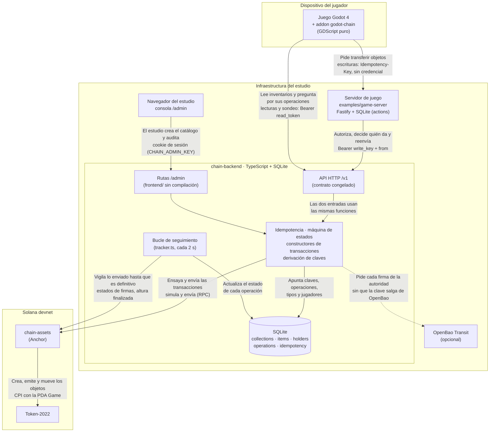
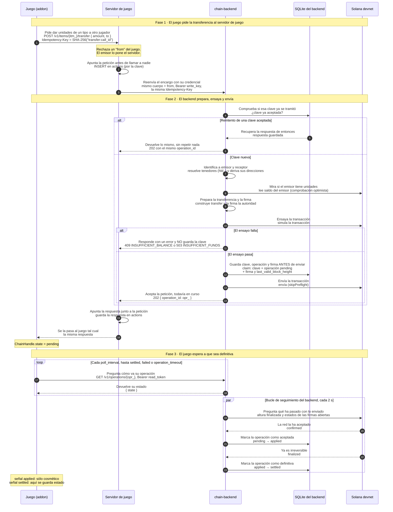
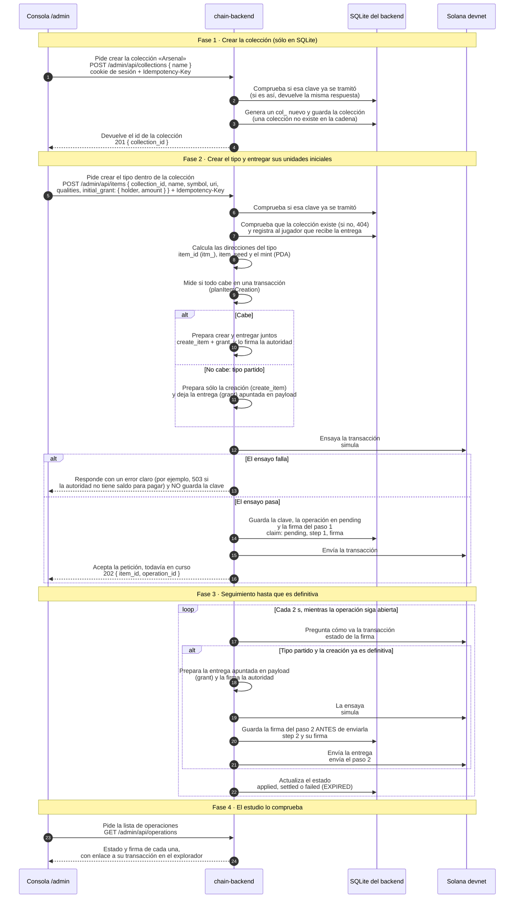
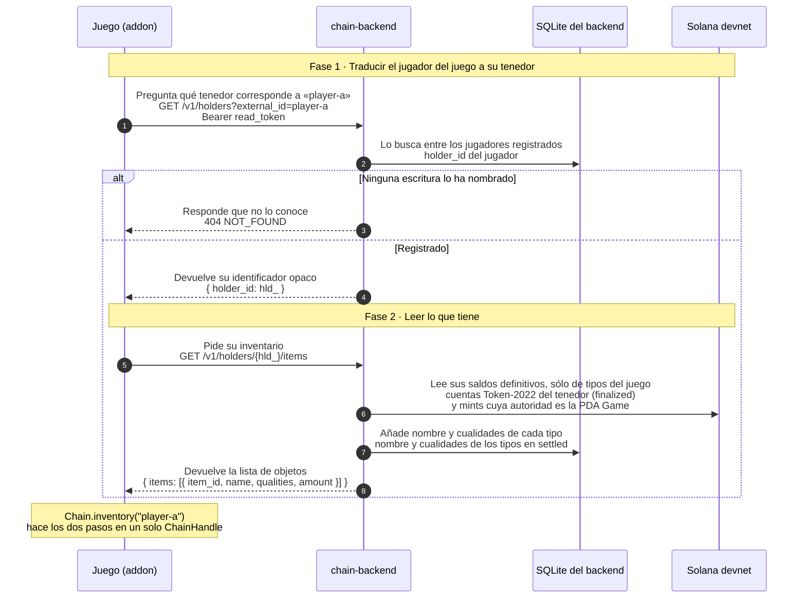
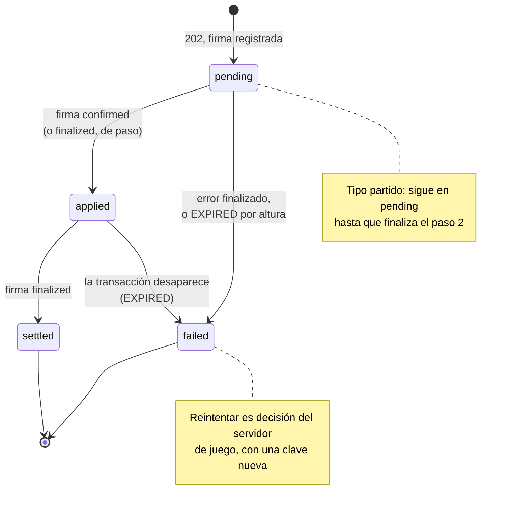
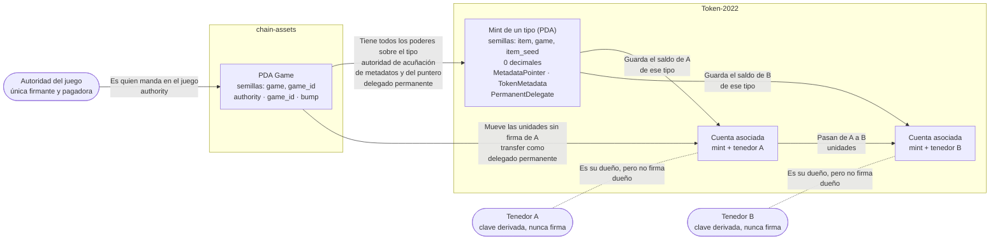
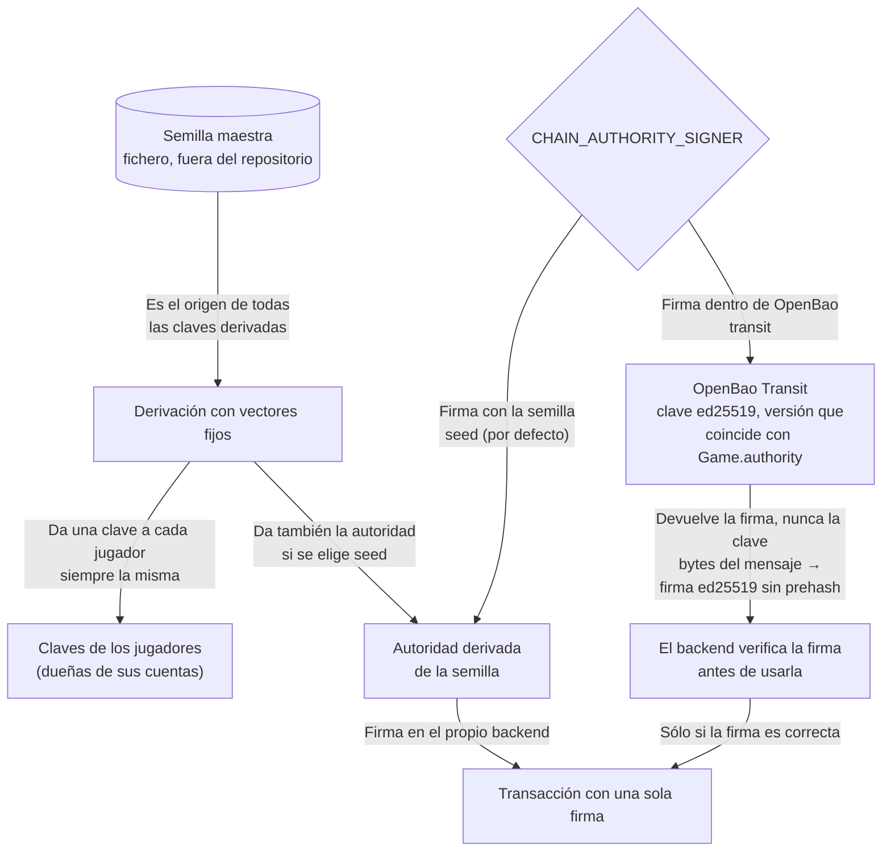

# Diagramas

Arquitectura y flujo de datos de `godot-chain`, en Mermaid. Describen lo que hay en el código, no lo
previsto: lo recortado (propuesta, 8.1) no aparece. La especificación es
`docs/especificacion/propuesta-pfm.md`, y el contrato, `docs/especificacion/http-contract.md`.

1. [Arquitectura: piezas y credenciales](#1-arquitectura-piezas-y-credenciales)
2. [Flujo de datos: una transferencia](#2-flujo-de-datos-una-transferencia)
3. [Flujo de datos: el estudio crea un tipo](#3-flujo-de-datos-el-estudio-crea-un-tipo)
4. [Flujo de datos: leer un inventario](#4-flujo-de-datos-leer-un-inventario)
5. [Estados de una operación](#5-estados-de-una-operación)
6. [Cuentas en la cadena](#6-cuentas-en-la-cadena)
7. [Quién firma como autoridad](#7-quién-firma-como-autoridad)

---

## 1. Arquitectura: piezas y credenciales

Cada flecha lleva la credencial con la que se llama. El juego sólo tiene el `read_token`, que va en
su binario y es público de facto (limitación 5). La `write_key` está en el servidor de juego, y la
clave de administración, en el navegador del estudio. La autoridad del juego no sale del backend, o de
OpenBao si se usa.

**Por qué las escrituras no van directas.** Una credencial dentro del binario del juego se extrae con
herramientas triviales, y quien decide que un jugador se ha ganado algo debe ser un servidor, no el
cliente que el jugador controla. Por eso el servidor de juego no es decorado: sin él, la arquitectura
sería insegura (propuesta, 3).

**Por qué la consola no usa la API.** Llama a las funciones del backend por dentro: ni la `write_key`
ni el `read_token` pasan por el navegador.

---

## 2. Flujo de datos: una transferencia

Es el camino del hito (propuesta, 7): el jugador A da una unidad a B desde la demo. Se ven los dos
invariantes de idempotencia: **marcar primero, llamar después**, en el servidor de juego y en el
backend, y **simular antes de reclamar la clave**, para no guardar una clave cuya operación no puede
ejecutarse.

---

## 3. Flujo de datos: el estudio crea un tipo

El catálogo lo crea el estudio en `/admin`; el servidor de juego responde `403` si el juego lo
intenta. Un tipo se crea con su entrega inicial a un jugador. Si sus campos no caben con el `grant` en
una sola transacción (V10, V13), el backend la **parte** en dos pasos: el segundo sale de
`operations.payload` cuando el primero está finalizado (P11).

---

## 4. Flujo de datos: leer un inventario

El juego conoce a su jugador por su propio identificador (`player-a`), no por una dirección. El addon
lo traduce a `holder_id` y lee. Los saldos se leen de la cadena, con compromiso `finalized`, no de
SQLite: SQLite sólo da el `item_id`, el nombre y las cualidades de los tipos, y sólo de los que están en
`settled`.

Las lecturas tienen límite de tasa por IP: 120 por minuto (P14).

---

## 5. Estados de una operación

Lo que ve el juego en `ChainHandle.state`, y lo que guarda `operations.state`. **El juego sólo escribe
estado en `settled`**; `applied` sirve para animar y no garantiza nada.

La caducidad se decide por la altura **finalizada**: si ya pasa del `last_valid_block_height` de la
firma y la firma no aparece, la transacción ya no puede entrar (P13). El backend no reenvía
transacciones: sólo guarda su firma.

---

## 6. Cuentas en la cadena

`chain-assets` no guarda saldos. Tiene los poderes sobre los mints Token-2022 a través de la PDA
`Game`, y los ejerce por CPI. Program ID en devnet: `4SUNiKmyk4QtXhU2oNGn6uiXiSUevRdmXpZdRFXPeLNz`.

| Instrucción | Firma | Qué hace |
|---|---|---|
| `initialize_game` | autoridad | Crea `Game` y fija la autoridad |
| `rotate_authority` | autoridad actual | Cambia la autoridad; los mints no cambian |
| `create_item` | autoridad | Crea el mint con sus extensiones y metadatos |
| `grant` | autoridad | Acuña a un tenedor y crea su cuenta si hace falta |
| `transfer` | autoridad | Mueve unidades entre tenedores; el emisor no firma |

Ningún mint tiene autoridad de congelación. Rotar la autoridad no toca los activos, porque los poderes
son de `Game`, no de la clave.

---

## 7. Quién firma como autoridad

Dos firmantes posibles, con `CHAIN_AUTHORITY_SIGNER`. En los dos casos la transacción lleva **una sola
firma** (invariante 1), y lo comprueba un test con cada uno.

Con Transit, la clave privada de la autoridad no sale nunca de OpenBao. La semilla sigue dando las
claves de los jugadores: quien la lea puede mover sus objetos, pero no crear tipos, emitir ni quedarse
con el juego (limitación 2). La rotación es `npm run rotate-authority` (V23).
